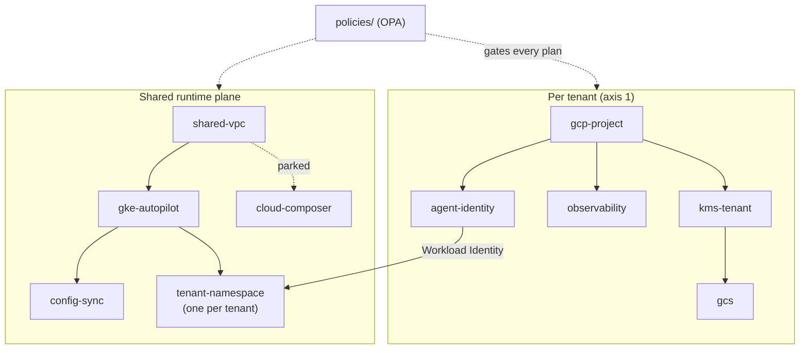

# multi-tenant-platform

Reusable, **versioned** Terraform modules (plus the OPA policies that gate them) for a multi-tenant GCP platform: a project-per-tenant isolation boundary with mandatory CMEK, a shared private GKE Autopilot runtime, a GitOps loop, and per-tenant namespace isolation for durable AI agents.

This is **repo 1 of 2**. It holds the building blocks and no tenant- or environment-specific values. The tenant registry, deployment roots, and CI/CD live in [`multi-tenant-config`](https://github.com/aidaploco/multi-tenant-config), which consumes these modules by **pinned git tag**, never `main`. The architecture and the reasoning behind it are in [ADR-0001](https://github.com/aidaploco/multi-tenant-config/blob/main/docs/adr/0001-platform-architecture.md).

> **This is a reference implementation.** It was built without a live GCP organization, so every module is validated with mocked-provider `terraform test` suites and OPA policy tests rather than applied to real infrastructure. Names such as `abf`, the `abf-dev-7f3a` project IDs, and `company.com` addresses in examples are fictional placeholders.

## How the pieces fit



## Consuming a module

Pin to a released tag. The tag is the stability contract:

```hcl
module "project" {
  source = "git::https://github.com/aidaploco/multi-tenant-platform.git//modules/gcp-project?ref=v0.1.0"
  # ...
}
```

Each module's README shows its own pinned example.

## Modules

| Module | Purpose |
| ------ | ------- |
| [`gcp-project`](modules/gcp-project) | The tenant isolation boundary: project + APIs + labels |
| [`kms-tenant`](modules/kms-tenant) | Per-tenant KMS keyring + CMEK keys with native rotation |
| [`gcs`](modules/gcs) | GCS bucket: CMEK-required, uniform access, private |
| [`observability`](modules/observability) | Log sink + alert policies + dashboard per resource |
| [`agent-identity`](modules/agent-identity) | Agent-unit archetype: runtime SA + Workload Identity binding + least-privilege IAM |
| [`shared-vpc`](modules/shared-vpc) | Runtime-plane private network: PGA, Cloud NAT, default-deny firewall, VPC-native ranges |
| [`gke-autopilot`](modules/gke-autopilot) | Shared runtime cluster: private Autopilot + Workload Identity, substrate CMEK |
| [`cloud-composer`](modules/cloud-composer) | Shared managed-Airflow plane: private environment + own SA (parked by default in `multi-tenant-config`) |
| [`config-sync`](modules/config-sync) | GitOps loop: installs Config Sync (Fleet) pointed at the `gitops/` directory |
| [`tenant-namespace`](modules/tenant-namespace) | Per-tenant namespace isolation: default-deny ingress/egress, quota, Workload Identity SA, narrowed RBAC |

Policies live in [`policies/`](policies) (Rego, with unit tests) and are consumed by `multi-tenant-config`'s CI at a pinned ref. They are authored once here, not duplicated.

Still outside this vertical slice: `vpc-sc`, `cloud-sql`, and `bigquery`/`pubsub` (the data-unit archetype's dependencies). They are deferred to activation, tracked in `multi-tenant-config`'s [`docs/PLAN.md`](https://github.com/aidaploco/multi-tenant-config/blob/main/docs/PLAN.md).

## Conventions

Every module ships `main.tf`, `variables.tf`, `outputs.tf`, `versions.tf`, a `README.md` (inputs/outputs generated by `terraform-docs`), and tests under `tests/*.tftest.hcl`.

- **Terraform `>= 1.9`**; provider major versions are bounded here, exact versions pinned in each consumer's `.terraform.lock.hcl`.
- **Required labels** on every resource: `tenant`, `environment`, `data_classification` (modules inject `managed-by = terraform`).
- **CMEK is mandatory** on stateful resources. Modules fail closed if no key is supplied; there is no silent fallback to Google-managed keys.
- **No service-account keys, ever.** Identity is keyless (Workload Identity / WIF).

## Local development

No cloud credentials are needed:

```bash
# From a module directory:
terraform fmt -check -recursive      # formatting
terraform init -backend=false        # install providers (no remote state)
terraform validate                   # configuration correctness
terraform test                       # unit tests with a MOCKED provider: no cloud, no cost

# From the repo root:
conftest verify -p policies          # OPA policy unit tests
```

CI runs the same checks, plus tflint and a gitleaks secret scan over the full history.

Versioning is **manual**: tags are cut by hand (`git tag vX.Y.Z` + push) after a merge to `main` and recorded in `multi-tenant-config`'s `VERSIONS.md`. Semantic-release on conventional commits is a tracked nice-to-have, not something already running.

## License

No license is granted. The source is published so it can be read and reviewed; please do not copy, redistribute, or reuse it without permission. All rights reserved.
